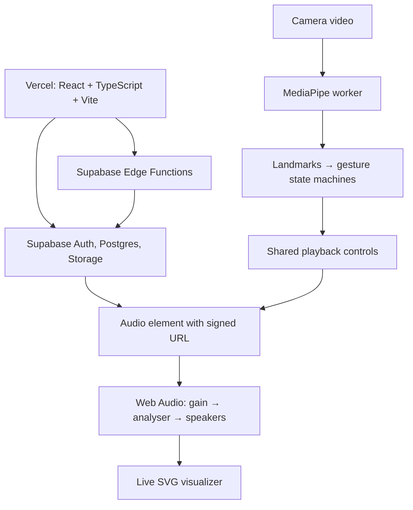

# Sound Garden

A gesture-controlled music studio built with React, Web Audio, and MediaPipe.
Upload your own tracks, watch a live visualizer, and control playback with your hand.

**[Try the live app](https://sound-garden-zeta.vercel.app/)** · **[Watch the demo](docs/media/sound-garden-demo.mov)**

## Try it

1. Create an account or sign in.
2. Upload an MP3 or WAV file, up to 20 MiB, that you have permission to use.
3. Select a track to start playback.
4. Enable the camera to use gestures. The preview shows hand landmarks and instructions.

Manual playback, seeking, volume, and mute controls remain available without a camera.
Camera access requires permission and HTTPS, or localhost during development.

## Gestures

| Gesture | Action |
|---|---|
| Pinch thumb and index finger, then move up/down | Increase/decrease volume |
| Release the pinch | Keep the current volume and stop adjusting |
| Hold an open palm for 0.6 seconds | Play or pause once |
| Lower or change your hand after a palm hold | Rearm play/pause |

Pinching captures the current volume without a jump. Movement is smoothed and
clamped; manual volume or mute input cancels the grab until you release. Hand loss
resets gesture input. The preview floats above the studio and can be dragged or
moved with arrow keys when its handle is focused.

## Features

- **Personal library:** email/password authentication, uploads, search, and deletion.
- **Playback:** seeking, volume, mute with restoration, and expiring signed audio URLs.
- **Live visualization:** 96 centered dark-green bars with fast attack and smooth decay.
- **Hand controls:** worker-based landmark detection, pinch-volume, and palm-hold playback.
- **Reliable uploads:** reservation → signed transfer → verification, retry handling,
  content-based deduplication, and cleanup for expired upload attempts.
- **Lifecycle handling:** camera disconnect recovery, startup cancellation, resource
  cleanup, and rejection of stale tracking results after tab switches.

## Architecture



**Frontend:** React, TypeScript, Vite, and React Router. `/` is the landing/auth page;
`/studio` is the authenticated music workspace.

**Audio:** one audio element feeds a Web Audio graph. The analyser runs after gain,
so slider and gesture volume changes also affect the visualizer. Visual gain is
4× for display only; it does not amplify the sound.

**Computer vision:** MediaPipe's pretrained Hand Landmarker runs in a Web Worker.
Our TypeScript logic interprets landmarks using geometric checks, hysteresis,
smoothing, and hold/rearm state machines. No custom model training is required.
Camera frames are processed locally, not uploaded to the backend.

**Backend:** Supabase Auth, PostgreSQL with row-level security, private Storage,
and Edge Functions for upload reservation, verification, deletion, and cleanup.
Storage and metadata changes are coordinated workflows, not one atomic transaction.

## Local development

Use a Node.js version supported by Vite 8, plus npm. The commands below assume
a macOS/Linux shell.

```sh
npm ci
cp .env.example .env.local
```

Set these values in `.env.local`:

```dotenv
VITE_SUPABASE_URL=https://YOUR_PROJECT.supabase.co
VITE_SUPABASE_PUBLISHABLE_KEY=YOUR_PUBLISHABLE_KEY
```

Only use a browser-safe publishable/anon key in the frontend. Service-role keys
and job secrets belong exclusively in backend configuration.

The MediaPipe model and WASM assets are included under `public/mediapipe/`.
If you upgrade `@mediapipe/tasks-vision`, refresh its matching runtime files:

```sh
cp -R node_modules/@mediapipe/tasks-vision/wasm/. \
  public/mediapipe/wasm/
```

Then start the frontend:

```sh
npm run dev
```

### Supabase setup

The frontend needs a configured Supabase backend; running Vite alone does not
provision it.

- Apply the repository's SQL migrations and configure the private audio bucket
  and owner-based access policies.
- Deploy `reserve-upload`, `finalize-upload`, `delete-track`, and `cleanup-uploads`.
- Configure required backend secrets and the cleanup schedule separately.
- Add your local and deployed authentication redirect URLs in Supabase Auth.

See the [upload workflow](docs/upload_workflow.md),
[Edge Function contracts](supabase/functions/reserve-upload/README.md), and
[cleanup setup and verification](docs/cleanup_workflow.md) for backend details.

## Tests and verification

```sh
npm test             # Strict type checks, then Vitest: browser logic + embedded database
npm run lint         # ESLint
npm run typecheck    # Strict application, Vite config, and test TypeScript checks
npm run build        # TypeScript + production frontend build
npm run test:edge    # Deno: Edge Function tests
npm run test:all     # Both test suites
```

Edge tests expect the local Deno executable configured in `package.json`.
Automated tests mock camera/media resources or use synthetic landmarks; they do
not replace real-camera checks for lighting, recognition quality, and latency.

See [test coverage and manual checks](tests/README.md) for specific cases.

For a camera-free check of real model initialization and one blank-image inference,
open `/tests/preview/handTrackingCheck.html` on the normal Vite development server.
This diagnostic is not included in the production app build.

## Deployment

The frontend is hosted on **Vercel**; Supabase hosts the backend.

- Framework preset: **Vite**.
- Build command: `npm run build`.
- Output directory: `dist`.
- Add the two `VITE_SUPABASE_*` variables to the deployment environment.
- `vercel.json` provides SPA routing so direct links and refreshes at `/studio` work.
- Configure Supabase Auth's Site URL and redirect allowlist for the production
  domain, retaining your local development URL.

MediaPipe assets are served with the frontend. Inference and visualization run in
the browser; they do not require Vercel server functions. Backend functions and
cleanup scheduling must be deployed/configured separately from the frontend.

## Code map and implementation notes

- `src/components/studio/`: library, player, visualizer, and floating camera UI.
- `src/hooks/useCamera.ts`: camera permission, stream lifecycle, and disconnects.
- `src/hooks/useHandTracking.ts`: worker lifecycle, frame transfer, and visibility fencing.
- `src/workers/handTracking.worker.ts`: model initialization and frame inference.
- `src/lib/gestures.ts`: pinch/palm geometry and interaction state machines.
- `src/hooks/useHandControls.ts`: gesture-to-player coordination.
- `src/hooks/useAudioPlayback.ts`: audio lifecycle, player state, and manual overrides.
- `supabase/functions/`: authenticated track workflows and job-only upload cleanup.
- `supabase/migrations/`: database functions, constraints, and authorization changes.

Further implementation details:

- [Playback and gesture workflow](docs/playback_workflow.md)
- [Upload workflow](docs/upload_workflow.md)
- [Duplicate prevention](docs/duplicate_prevention.md)
- [Deletion workflow](docs/delete_workflow.md)
- [Cleanup workflow](docs/cleanup_workflow.md)

## Development performance measurements

Use `/studio?benchmark=1` on the local Vite server for opt-in tracking latency and throughput measurement. See the [benchmark procedure](docs/benchmarks/README.md). The panel and collection code are excluded from production builds.

## Guest demo

Open [/demo](https://sound-garden-zeta.vercel.app/demo) or select **Try demo** on the landing page. No account is needed. Select the included sample to start playback, then optionally enable the camera for gesture controls.

The demo is sample-only: upload, deletion, and search controls are hidden. Sign in to upload your own music and use the persistent personal library. The demo shares the studio player, visualizer, and gestures; it does not call Supabase library or storage endpoints. Camera frames continue to be processed locally.

Sample: **“Cipher” by Kevin MacLeod (incompetech.com)**, licensed under [CC BY 4.0](https://creativecommons.org/licenses/by/4.0/). The bundled MP3 is unmodified; playback supports live volume changes. See [audio attribution](public/audio/ATTRIBUTION.md) for the official source and license. The audio license is separate from the application code.

Demo tests cover public/protected routing, auth failures, sample playback without signed URLs, and the absence of upload, deletion, and search controls. Run `npm test`, `npm run lint`, and `npm run build`.
